<!--
This template is adapted from Kubernetes Enhancements KEP template https://raw.githubusercontent.com/kubernetes/enhancements/a86942e8ba802d0035ec7d4a9c992f03bca7dce9/keps/NNNN-kep-template/README.md
-->

# ACME DNS-PERSIST-01 challenge solver

- **Status:** Draft (2026-10-18)
- **Feature gate (proposed):** `ACMEDNSPersist01` (controller + webhook), alpha, off by default
- **Target release:** not proposed yet; see [Open Questions](#open-questions) 2
- **Tracking issue:** [#8373](https://github.com/cert-manager/cert-manager/issues/8373)
- **Specification:** [draft-ietf-acme-dns-persist-02][draft02] (2026-09-20)
- **Prior art:** [sheurich/cert-manager#2][forkpr], by one of the draft's authors (see [Relationship to the prototype](#relationship-to-the-prototype))

<!-- toc -->
- [Release Signoff Checklist](#release-signoff-checklist)
- [Summary](#summary)
- [Motivation](#motivation)
  - [Goals](#goals)
  - [Non-Goals](#non-goals)
- [Proposal](#proposal)
  - [User Stories](#user-stories)
    - [Story 1: DNS changes go through change management](#story-1-dns-changes-go-through-change-management)
    - [Story 2: no DNS credentials in the cluster](#story-2-no-dns-credentials-in-the-cluster)
  - [Notes/Constraints/Caveats](#notesconstraintscaveats)
  - [Risks and Mitigations](#risks-and-mitigations)
- [Design Details](#design-details)
  - [The protocol in draft -02](#the-protocol-in-draft--02)
  - [API](#api)
  - [ACME library](#acme-library)
  - [Where the account URL comes from](#where-the-account-url-comes-from)
  - [Controller behaviour](#controller-behaviour)
  - [Self-check](#self-check)
  - [Interaction with other solvers and selectors](#interaction-with-other-solvers-and-selectors)
  - [Wildcards and parent domains](#wildcards-and-parent-domains)
  - [Feature gate](#feature-gate)
  - [Relationship to the prototype](#relationship-to-the-prototype)
  - [Test Plan](#test-plan)
  - [Graduation Criteria](#graduation-criteria)
  - [Upgrade / Downgrade Strategy](#upgrade--downgrade-strategy)
  - [Supported Versions](#supported-versions)
- [Production Readiness](#production-readiness)
- [Drawbacks](#drawbacks)
- [Alternatives](#alternatives)
- [Open Questions](#open-questions)
<!-- /toc -->

## Release Signoff Checklist

This checklist contains actions which must be completed before a PR implementing this design can be merged.

- [ ] This design doc has been discussed and approved
- [ ] Test plan has been agreed upon and the tests implemented
- [ ] Feature gate status has been agreed upon (whether the new functionality will be placed behind a feature gate or not)
- [ ] Graduation criteria is in place if required (if the new functionality is placed behind a feature gate, how will it graduate between stages)
- [ ] User-facing documentation has been PR-ed against the release branch in [cert-manager/website][]

[cert-manager/website]: https://github.com/cert-manager/website

## Summary

`dns-persist-01` is a new ACME challenge type defined by the IETF ACME working group draft [draft-ietf-acme-dns-persist][draft02]. The domain owner publishes one long-lived TXT record at `_validation-persist.<domain>`. The record names the CA and binds the domain to one ACME account. The CA checks that record whenever it validates an authorization, so no DNS change is needed when a certificate is issued or renewed.

This design adds an alpha `dnsPersist01` solver to the ACME issuer:

```yaml
solvers:
- selector:
    dnsZones: ["example.com"]
  dnsPersist01: {}
```

cert-manager never writes or deletes the record, so the solver has no DNS provider and no credentials. For each Challenge, cert-manager computes the record value the CA expects, shows it in `Challenge.spec.key`, checks DNS for a matching record (the self-check), and then asks the CA to validate. The feature targets draft -02 only, sits behind the `ACMEDNSPersist01` feature gate (alpha, off by default), and builds on the prototype in [sheurich/cert-manager#2][forkpr].

## Motivation

- Users asked for it: [#8373][i8373] has 175 thumbs-up reactions (2026-10-18), and [#8530](https://github.com/cert-manager/cert-manager/issues/8530) is a duplicate.
- The CA/Browser Forum ballot that allows this validation method passed in October 2025, according to [Let's Encrypt's announcement](https://letsencrypt.org/2026/02/18/dns-persist-01.html) (2026-02-18).
- Today, DNS-01 needs DNS API credentials in the cluster, or a CNAME delegation of `_acme-challenge`. With dns-persist-01, cert-manager needs no DNS write access at all, which removes some of the most powerful credentials cert-manager holds.
- This is still a new in-tree solver. The [roadmap](https://github.com/cert-manager/community/blob/main/ROADMAP.md)'s "Shrinking Core / Aiding Extensibility" item (read 2026-10-18) asks to move the ACME issuer and the DNS solvers out of core, and to prefer integration points over additions to core. So the roadmap does not argue for this feature; see [Drawbacks](#drawbacks) and [Open Questions](#open-questions) 1.
- One of the draft's authors wrote a cert-manager prototype ([sheurich/cert-manager#2][forkpr], last updated 2026-03-18) against draft -01. Draft -02 changed the record format, so the prototype needs rework, and the author has [welcomed a design document based on -02](https://github.com/cert-manager/cert-manager/issues/8373#issuecomment-6244844303) (2026-10-18).

### Goals

- ACME Issuers and ClusterIssuers can solve `dns-persist-01` challenges with a `dnsPersist01` solver that has no credentials.
- cert-manager computes the exact record value for draft -02 (hashed `accounturi`), shows it to the user after the draft's account check, and checks DNS for it before asking the CA to validate.
- The solver works with the existing selectors, alongside `http01` and `dns01` solvers.
- When the gate is off, or the CA does not offer a usable dns-persist-01 challenge, behaviour is unchanged.
- Unit tests use the draft's test vectors. E2E tests run against Pebble.

### Non-Goals

- **Publishing the record.** cert-manager will not create, update or delete `_validation-persist` records through DNS providers. That would need write-once and `persistUntil` handling per provider and would bring DNS credentials back. It could be a separate design later.
- **Draft -00 and -01.** The record format changed incompatibly in -02 (see [The protocol in draft -02](#the-protocol-in-draft--02)). cert-manager implements one revision at a time.
- **Validating at a parent domain.** The draft has no way yet for a client to ask the CA to validate at an ancestor domain ([ietf-wg-acme/draft-ietf-acme-dns-persist#33][wg33], open). See [Wildcards and parent domains](#wildcards-and-parent-domains).
- **ACME account key rollover.** cert-manager does not use the RFC 8555 `keyChange` flow today, and this design does not add it.
- **Other new challenge types**, such as `dns-account-01` ([#9388](https://github.com/cert-manager/cert-manager/issues/9388)), and IP address identifiers.
- **Hash algorithms other than `sha-256`**, the only one the draft makes mandatory.

## Proposal

### User Stories

#### Story 1: DNS changes go through change management

A platform team's DNS zone is changed only through tickets. Today they delegate `_acme-challenge` with CNAMEs or hand a DNS-01 webhook a broad API token. With this feature, the DNS team publishes one record per domain, once:

```
_validation-persist.app.example.com. IN TXT "authority.example; accounturi=https://ca.example/account-hash/sha-256/<hash>"
```

The platform team adds a `dnsPersist01` solver for `example.com`. Issuance and renewals need no further DNS change for as long as the record stays in place and the ACME account is unchanged. A record with `policy=wildcard` also covers `*.app.example.com`.

#### Story 2: no DNS credentials in the cluster

A team does not want any DNS write credentials in the cluster. They use `dnsPersist01` for every DNS name. To get the value to publish, they either compute it from the account URL and the account key's thumbprint (draft section 4.5), or create the Certificate first and copy the value from `kubectl describe challenge`. cert-manager runs the account check from section 4.5 before it shows the value (see [Where the account URL comes from](#where-the-account-url-comes-from)). The Challenge waits, re-checking DNS with a growing interval, until the record appears.

### Notes/Constraints/Caveats

- **The record belongs to the user.** cert-manager never removes it. Removing the record, or deactivating the ACME account, is how a domain owner revokes it (draft section 7.11).
- **The record is bound to the ACME account and its key.** The hashed `accounturi` covers the account URL and the account key's JWK thumbprint.
  - If the Issuer's account key Secret is replaced with a new key that was not rolled over onto the same account, cert-manager registers or looks up a different account, so every record must be published again.
  - If the key was instead rolled over on the same account with RFC 8555 `keyChange` (outside cert-manager), the account URL stays the same. The CA must keep accepting records made with the old key (draft sections 4.1 item 3, 4.2 and 7.2.1), but the self-check only knows the current key, so it does not match them (see [Risks and Mitigations](#risks-and-mitigations)). Section 7.2.1 asks clients to republish after a rotation, and `spec.key` shows the new value.
  - The same applies when moving between ACME servers (for example staging and production): each server has its own accounts and its own Issuer Domain Names, so each needs its own record. Several records can coexist at the same name (draft section 4.3).
- **Persistence raises the value of the account key.** Anyone holding the account key can get certificates for every domain that has a record for that account, without touching DNS (draft section 7.2). The docs will say this, and will recommend RBAC on the account key Secret, `persistUntil`, separate accounts for separate trust domains, and CAA `accounturi`.
- **The self-check sees DNS from inside the cluster.** With split-horizon DNS, the cluster may not see the public record. The solver has its own `nameservers` field for this, and the existing `waitInsteadOfSelfCheck` escape hatch also applies.
- **Just-in-time validation.** A CA may validate an existing record when the authorization is created and return it already valid (draft section 4.4). cert-manager already creates no Challenge for valid authorizations (`pkg/controller/acmeorders/util.go`). A just-in-time lookup that finds no record can leave a negative answer in the CA's resolver cache; the self-check waits after a newly published record matches (see [Self-check](#self-check)).
- **No production CA yet.** As of 2026-10-18 we could not find a CA that has announced production support for -02. Let's Encrypt's [challenge types page](https://letsencrypt.org/docs/challenge-types/) does not list dns-persist-01. Boulder added draft -00 in [letsencrypt/boulder#8660](https://github.com/letsencrypt/boulder/pull/8660) and moved to -01 in [#8725](https://github.com/letsencrypt/boulder/pull/8725); we found no PR for -02, and Boulder `main` (`cf6406dd`, 2026-10-15) still names the challenge field `issuer-domain-names` (`core/objects.go`). Pebble has partial -02 support open in [letsencrypt/pebble#566][pebble566]: at its head `df066f8f` (read 2026-10-18) it adds the hashed `accounturi` check and the two directory fields, but its challenge objects still carry the -01 `issuer-domain-names` and `accounturi` fields (`acme/common.go`, unchanged by the PR).

### Risks and Mitigations

| Risk | Mitigation |
|---|---|
| **The draft changes again.** -02 changed the record format, and four WG issues are open (#32, #33, #39, #69). The two commits merged after -02 (2026-10-07) only change examples and CA guidance. | Alpha, off by default. Parsing and hashing are small isolated units with the draft's test vectors. Alpha follows the newest draft revision and never supports two revisions at once. Release notes say which revision each release implements. |
| **Self-check false negative.** The Challenge waits until the authorization expires. Causes: split-horizon DNS; a CA that validates at a parent domain; a non-sha-256 record; a record made with a prior key of the same account, which the CA still accepts (sections 4.1 item 3, 4.2; open WG issue [#69][wg69]); a record under the old `accountHashPrefix` while a CA migrates prefixes, which the CA must also accept (section 4.5). | Per-solver `nameservers`, and `waitInsteadOfSelfCheck`. The Challenge `reason` explains what was found and why it did not match, and for an `accounturi` mismatch it says that a record made with a prior key or prefix may still be accepted by the CA. |
| **Self-check false positive.** The CA rejects a record the self-check accepted. One cause is a negative answer cached by the CA's resolver after a just-in-time lookup (section 4.4) for a record published after the Challenge was created. | The 60-second wait after a newly published record matches (see [Self-check](#self-check)). Otherwise the Challenge fails, and the Order fails and is retried with the existing backoff. Tests keep the matching rules close to the draft's CA rules. |
| **Waiting Challenges hold scheduler slots.** The scheduler counts every Challenge with `status.processing=true` against `--max-concurrent-challenges` (default 60), and a dns-persist-01 Challenge can wait hours for a person. 60 of them would stop every HTTP-01 and DNS-01 Challenge in the cluster. | DNS-PERSIST-01 Challenges get their own budget in the scheduler, and the self-check interval grows while a Challenge waits (see [Controller behaviour](#controller-behaviour) step 6 and [Self-check](#self-check)). |
| **The account URL is wrong or missing.** [#7846][i7846] reports `status.acme.uri` going empty on some Issuers. | The account URL comes from the ACME client, not from Issuer status, and is verified with the section 4.5 account check (see [Where the account URL comes from](#where-the-account-url-comes-from)). |
| **A compromised account key can issue for every domain with a record.** | Documentation (see Caveats). This is inherent to the method and the draft discusses it in section 7.2. |
| **A change to the forked ACME client**, while [#9431](https://github.com/cert-manager/cert-manager/pull/9431) is shrinking the fork. The fork is synced from [cert-manager/crypto](https://github.com/cert-manager/crypto) with klone, not edited here. | The fork change is limited to three parsed fields and one account-check method, and lands in cert-manager/crypto first. Hashing and record logic live in cert-manager. See [ACME library](#acme-library) and [Open Questions](#open-questions) 3. |

## Design Details

### The protocol in draft -02

All references are to [draft-ietf-acme-dns-persist-02][draft02].

- **Record name:** `_validation-persist.<FQDN>`, where FQDN is the identifier being validated (section 4).
- **Record value:** an RFC 8659 `issue-value`: `<issuer-domain-name>; accounturi=<hashed URI>[; policy=wildcard][; persistUntil=<unix time>]`. Unknown parameters are ignored (section 4.1). Values longer than 255 octets are split into several character-strings and concatenated (section 9.1).
- **Issuer Domain Names:** the challenge object carries `issuerDomainNames` (C). The server must send 1 to 10 lowercase A-label names with no trailing dot, each at most 253 octets (section 3.1). The directory `meta` object also carries `issuerDomainNames` (D), and the CA must put every name in D into every C and, if it advertises `caaIdentities` (I), every name in C into I (section 3.2). The client side is narrower:
  - A client must reject a challenge whose C is empty or has more than 10 entries (section 3.1).
  - D is "available" only if it is present and conforming. I is available only if `caaIdentities` is present and conforming, and its values are compared as lowercase A-labels with no trailing dot. When D is available, a challenge missing a name in D is malformed. When I is available, a challenge with a name not in I is malformed (section 3.2).
- **Hashed account URI** (section 4.1):

  ```
  accounturi = <accountHashPrefix> "sha-256/" base64url(SHA-256(len(domain) || domain || thumbprint || accountURL))
  ```

  - `accountHashPrefix` comes from the directory `meta` object. A CA offering dns-persist-01 must advertise it (section 4.1 item 3).
  - `len(domain)` is one octet. `domain` is the normalized FQDN the record is published at, or the single octet `*` to opt out of the per-domain hash (the same value can then be reused for every domain).
  - `thumbprint` is the 43-character unpadded base64url SHA-256 JWK thumbprint of the account key (RFC 7638), the same value used in ACME key authorizations.
  - `accountURL` is the account URL from the `Location` header of the newAccount response.
  - base64url has no padding.
- **Test vector** (section 10.2): domain `example.com`, thumbprint `NzbLsXh8uDCcd-6MNwXF4W_7noWXFZAfHkxZsRGC9Xs`, account URL `https://ca.example/acct/123`, prefix `https://ca.example/account-hash/`:
  - domain form: `https://ca.example/account-hash/sha-256/5SQm7n6tPh2-PlLbCKGnViTXX5z19SCN4cPGQHSk-kw`
  - `*` form: `https://ca.example/account-hash/sha-256/NpDnSwUthQK8zCgFdefYxAdAVPnygMLbs9US6oO-5ug`

  We reproduced both values on 2026-10-18, deriving the thumbprint from the RFC 7638 section 3.1 example key with cert-manager's own `JWKThumbprint` (`third_party/forked/acme/jws.go`). The draft's thumbprint is that example key's thumbprint.
- **CA checks** (sections 4.2, 5, 4.1):
  - The issuer-domain-name must be in the challenge's list.
  - The `accounturi` must equal, as a plain string, a value the CA recomputes for the requesting account: in the domain form or the `*` form, over the account's current key and every prior key the CA has retained for it (sections 4.1 item 3 and 4.2). While a CA migrates its `accountHashPrefix` or account-URL structure, it must accept both the old and the new form (section 4.5). Records of a deactivated account never validate.
  - `policy=wildcard` (case-insensitive) is required for wildcard certificates and subdomains.
  - A record whose `persistUntil` has passed, or is not a base-10 integer, is rejected.
- **Pre-publication account check** (sections 4.5 and 9.4): before a client hands the inputs or the computed value to someone else to publish, it must send a POST-as-GET (JWS payload `""`, not `"{}"`) to exactly the account URL used in the hash, follow no redirects, and require the returned account `status` to be `valid`. A successful check for an unchanged (account URL, key) pair may be reused.
- **What changed from -01** (Change Log of -02): -01 used the raw account URL as `accounturi` and put it in the challenge object, and named the array `issuer-domain-names`. -02 drops `accounturi` from the challenge object, renames the array, adds the two directory fields, makes the hashed URI the only form, and adds the pre-publication account check.

### API

The ACME API types in `pkg/apis/acme/v1` (and the internal copy in `internal/apis/acme`) get a new solver type:

```go
type ACMEChallengeSolver struct {
	// ...existing selector, http01, dns01, waitInsteadOfSelfCheck...

	// Configures cert-manager to complete authorizations with the
	// dns-persist-01 challenge (draft-ietf-acme-dns-persist).
	// cert-manager does not create or delete the _validation-persist TXT
	// record; it must be published out of band. The value to publish is shown
	// in the Challenge's spec.key.
	// Requires the ACMEDNSPersist01 feature gate.
	// +optional
	DNSPersist01 *ACMEChallengeSolverDNSPersist01 `json:"dnsPersist01,omitempty"`
}

// ACMEChallengeSolverDNSPersist01 configures the dns-persist-01 solver.
// It needs no credentials, because cert-manager never writes the record.
type ACMEChallengeSolverDNSPersist01 struct {
	// Nameservers to use for the dns-persist-01 self-check. Same format and
	// meaning as dns01.nameservers: if set, they replace the controller's
	// global DNS01 recursive nameservers for this solver, and the
	// authoritative nameserver check is skipped.
	// +optional
	// +listType=atomic
	Nameservers []string `json:"nameservers,omitempty"`
}
```

- `ACMEChallengeType` gets `ACMEChallengeTypeDNSPersist01 = "DNS-PERSIST-01"`, and the enum becomes `HTTP-01;DNS-01;DNS-PERSIST-01`. This follows the existing pattern, where the value is the ACME challenge type upper-cased (`http-01` → `HTTP-01`, `dns-01` → `DNS-01`), and matches the title of #8373. The prototype uses `DNS-Persist-01`; enum values are permanent API, so we would rather not carry that spelling.
- `ChallengeSpec` gets `IssuerDomainNames []string` with the JSON tag `issuerDomainNames,omitempty` (`+optional`, `MaxItems=10`, items `MaxLength=253`, `+listType=atomic`). It is the challenge's `issuerDomainNames`, which the self-check needs. `omitempty` matters here: Challenge names are an FNV-32 hash of `json.Marshal(spec)` (`util.ComputeName`, `pkg/api/util/names.go`). Without it, every existing spec would marshal `"issuerDomainNames":null`, so after an upgrade every in-flight Order would compute new Challenge names, create duplicates and delete the old ones as leftovers. `dnsPersist01` already has `omitempty`, and the new Order field gets it too.
- `ChallengeSpec.Key` keeps its meaning, "the value to present". For DNS-PERSIST-01 it is the full TXT value cert-manager expects, for example `authority.example; accounturi=https://ca.example/account-hash/sha-256/5SQm…-kw`, plus `; policy=wildcard` for wildcard Challenges. The field docs are updated.
- `ACMEChallenge` in `Order.status.authorizations[].challenges` gets the same `IssuerDomainNames` field (`issuerDomainNames,omitempty`), so the Order controller can carry it from the authorization to the Challenge. `ValidateOrderStatusUpdate` (`internal/apis/acme/validation/order.go`) makes it immutable once set, like the challenge's `url`, `type` and `token`.
- Webhook validation (`ValidateACMEIssuerChallengeSolverConfig`, `internal/apis/certmanager/validation/issuer.go`):
  - `dnsPersist01` counts as a solver type, so it is mutually exclusive with `http01` and `dns01` in one solver entry.
  - `nameservers` is validated like `dns01.nameservers`.
  - With the gate off, an Issuer or ClusterIssuer that adds a `dnsPersist01` solver is rejected. An update that keeps existing `dnsPersist01` solvers unchanged is still allowed. The webhook also validates status updates (the validating webhook matches `*/*`), so without this the controller could not update the status of an Issuer created while the gate was on. `ValidateUpdateIssuer` and `ValidateUpdateClusterIssuer` (`clusterissuer.go`) both receive the old object but ignore it today, so the ratchet is wired into both. This ratchet goes beyond the [feature-gates guide](https://cert-manager.io/docs/contributing/featuregates/), which rejects a gated field outright and asks users to remove it before turning a gate off; the ML-DSA design (`design/20261007.mldsa-private-keys.md`) uses the same ratchet.
- Generated code (deepcopy, conversion, OpenAPI, apply configurations) and the CRDs for Issuers, ClusterIssuers, Orders and Challenges are regenerated with `make generate`, which runs both `generate-codegen` and `generate-crds`.

No field is added to Issuer status in alpha. See [Open Questions](#open-questions) 4.

### ACME library

The forked ACME client (`third_party/forked/acme`) drops fields it does not know about, so it needs a small change. The fork is not edited in this repository: `make update-third-party` syncs it with klone from [cert-manager/crypto](https://github.com/cert-manager/crypto) (`third_party/klone.yaml`, `make/third_party.mk`), and every fork change so far also bumped `repo_hash` in `klone.yaml`. So the fork part lands as a PR to cert-manager/crypto first, followed by a `repo_hash` bump here, as #9431 does.

In cert-manager/crypto:

- `Directory` gets `AccountHashPrefix string` and `IssuerDomainNames []string`, parsed from the directory `meta` object in `Discover`.
- `Challenge` gets `IssuerDomainNames []string`, parsed from the challenge's `issuerDomainNames` (the -02 name only).
- `VerifiedAccountURL(ctx) (string, error)`: returns the account URL the client uses as its JWS `kid` (the existing `accountKID` lookup: at most one `newAccount` request with `onlyReturnExisting`, then cached in `Client.KID`), after running the section 4.5 account check on it once (see [Where the account URL comes from](#where-the-account-url-comes-from)). It needs the fork's unexported `postAsGet` and `accountKID`, so it has to live in the fork.

In cert-manager:

- `AccountKeyThumbprint() (string, error)`: `JWKThumbprint(Key.Public())`. `Client.Key` and `JWKThumbprint` are already exported (`acme.go`, `jws.go`), so this does not need the fork. But `pkg/acme/client.Interface` is satisfied by `*acme.Client` directly (compile-time assertion in `interfaces.go`), so exposing it through the interface needs either a one-line fork method or a small wrapper around the client; the implementation PR will do whichever maintainers prefer.
- Both are exposed through `pkg/acme/client.Interface`, the logging middleware and `FakeACME`.

Everything else stays in cert-manager, in a new package `pkg/issuer/acme/dnspersist`:

- `HashedAccountURI(prefix, domain, thumbprint, accountURL string) (string, error)`: a pure function. It rejects domains longer than 255 octets.
- `Record(issuerDomainName, accountURI string, wildcard bool) string`: builds the value for `spec.key`.
- `ParseIssueValue`: parses a TXT value with the RFC 8659 `issue-value` grammar.
- `NormalizeDomain`: section 9.2 normalization, using `golang.org/x/net/idna` (already in the module graph as an indirect dependency).

This keeps the fork change small and keeps the logic most likely to change with the draft out of the fork. Adding the fields to upstream `golang.org/x/crypto/acme` instead is an option, but we expect upstream not to want fields from an unfinished draft (our guess, not something the Go team has said). See [Open Questions](#open-questions) 3.

### Where the account URL comes from

The hash covers the account URL, so cert-manager must use exactly the URL the CA associates with the account.

- **Source:** the ACME client's own account URL (`VerifiedAccountURL`). This is the `kid` the client puts in every signed request (RFC 8555 section 6.2), so it is the URL the CA sees. Usually it is already cached, because the Order was created with it. The fork learns it from the `Location` header of a `newAccount` request with `onlyReturnExisting`, which is not a request to the account URL itself.
- **Account check (draft sections 4.5 and 9.4).** A client that hands the record inputs or value to someone else to publish must first verify the account URL. cert-manager never publishes the record; it shows the value to whoever reads the Challenge or its Events, so it treats that as delegation. Before `ensureKeysForChallenges` writes a dns-persist-01 `spec.key`, `VerifiedAccountURL`:
  - sends a POST-as-GET to exactly the `kid` URL: KID-form JWS signed with the current account key, payload `""` (the fork's existing `postAsGet`)
  - follows no redirects (the request uses a copy of the client's `http.Client` whose `CheckRedirect` returns `http.ErrUseLastResponse`, and a 3xx response is an error)
  - requires the returned account `status` to be `valid`
  - caches the result on the client. Section 4.5 allows reusing a successful check for an unchanged (account URL, key) pair, and the accounts registry already builds a new client when the account key changes, so this is one request per ACME client.

  If the check fails, the Challenge is not created: the Order gets a Warning Event and the sync returns an error, so it is retried with the normal rate limit. cert-manager does not check account status today (the check in `registerAccount`, `pkg/issuer/acme/setup.go`, is commented out with a TODO about Pebble); this adds it for dns-persist-01 only. Pebble already returns `status` for a POST-as-GET to the account URL (`wfe.UpdateAccount`).
- **Not `Issuer.status.acme.uri`.** [#7846][i7846] (open, labelled `kind/bug`) reports this field going empty on working ClusterIssuers, and one reporter linked it to this feature on 2026-03-26. `pkg/issuer/acme/setup.go` clears it in two places and sets it only after a full registration check.
- **Cross-check:** if `status.acme.uri` is set and differs from the client's URL, cert-manager uses the client's URL and emits a Warning event on the Order, because records computed from the status value would not validate. (This Event can be deferred; see [Graduation Criteria](#graduation-criteria).)
- **Users still need the URL** to compute records before the first order. So fixing #7846 matters for usability, but not for correctness (see [Open Questions](#open-questions) 5).

### Controller behaviour

```mermaid
flowchart LR
  A["Order controller<br/>fetch authorizations"] -->|"gate on: copy issuerDomainNames<br/>only for usable challenges"| B["solver picker"]
  B -->|"dnsPersist01 solver +<br/>challenge with issuerDomainNames"| C["ensureKeysForChallenges<br/>account check (4.5), then<br/>spec.key = expected TXT value"]
  C --> D["Challenge controller<br/>Present: no-op + event"]
  D --> E["readiness: self-check<br/>TXT lookup, retry with<br/>growing interval"]
  E -->|"match (+60s if the record<br/>was newly published)"| F["Accept (POST challenge URL)<br/>CA validates"]
  F --> G["CleanUp: no-op"]
```



1. **Order controller, `fetchMetadataForAuthorizations`** (`pkg/controller/acmeorders/sync.go`), only when the gate is on. The Order status keeps every challenge the CA offered, as today. For a `dns-persist-01` challenge, `issuerDomainNames` is copied into the status only if the challenge is usable, and left empty otherwise. A challenge is not usable if:
   - its list is empty or has more than 10 entries (section 3.1, a client MUST)
   - D is available and one of its names is missing from the list (section 3.2)
   - I is available and a name in the list is not in I, after normalizing I to lowercase A-labels with no trailing dot (section 3.2)
   - an entry is not a lowercase A-label without a trailing dot, or is longer than 253 octets. The draft puts this rule on the server (section 3.1); cert-manager checks it too, rather than guess a normalization, because the name goes into the record. The prototype trims whitespace and trailing dots instead.
   - the directory has no `accountHashPrefix`. A CA offering dns-persist-01 must advertise one, and the hash cannot be computed without it.

   An unusable challenge is logged at debug level. It gets a Warning Event on the Order only if the Issuer has a `dnsPersist01` solver. -00 and -01 servers send `issuer-domain-names`, so their challenges always end up here; that includes cert-manager's current e2e Pebble, which offers dns-persist-01 on every DNS authorization (`cert-manager/pebble@9fc4fcab`, `wfe.makeChallenges`). Without the gate and the solver condition, every e2e Order, and every user Order against such a server, would get this Event.
2. **Picker** (`pkg/util/solverpicker`): a solver with `dnsPersist01` matches a `dns-persist-01` challenge only when the gate is on and the challenge's `issuerDomainNames` is non-empty. Orders whose status was filled before the upgrade, or before the gate was turned on, have dns-persist-01 entries with no list, so they are never selected and the picker falls through to other solvers. Selector logic is unchanged.
3. **`challengeType`** maps `dns-persist-01` to `DNS-PERSIST-01`, and `partialChallengeSpecForAuthorization` copies `IssuerDomainNames` into the ChallengeSpec. Challenge names are computed from the partial spec as today (see [API](#api) for why the new field must be `omitempty`).
4. **`ensureKeysForChallenges`** runs the account check (`VerifiedAccountURL`, see [Where the account URL comes from](#where-the-account-url-comes-from)) and then sets `spec.key`:
   - **Issuer domain name:** the first name from the directory's `issuerDomainNames` when D is available (section 3.2 guarantees it is in the challenge's list), or else the challenge's first name.
   - **Hashed URI:** the domain form for `spec.dnsName`.
   - **Wildcard:** `; policy=wildcard` is appended for wildcard Challenges.
   - The function gets a `context.Context` for the account check. The `*` form is not shown in `spec.key`; the docs explain how to use it.
5. **Challenge controller** (`pkg/controller/acmechallenges`):
   - `solverFor` returns the new solver for `DNS-PERSIST-01`.
   - `Present` writes nothing. The existing "Presented" event gets a type-specific message: "cert-manager does not publish dns-persist-01 records; waiting for a TXT record at `_validation-persist.<name>`; the expected value is in spec.key". The value is not secret: it is meant to be published in DNS.
   - `Check` is the self-check described below, run through the existing readiness evaluator. While it fails, `status.reason` is "Waiting for DNS-PERSIST-01 challenge propagation: …" and the Challenge is re-queued with the growing interval described in [Self-check](#self-check). `waitInsteadOfSelfCheck` works unchanged.
   - Acceptance and `WaitAuthorization` are unchanged.
   - `CleanUp` is a no-op. `finalize` skips CleanUp for `DNS-PERSIST-01` without needing the solver, so finalizers are removed even when the gate has been turned off.
6. **Scheduler** (`pkg/controller/acmechallenges/scheduler`):
   - DNS-PERSIST-01 Challenges are counted against their own budget: up to `--max-concurrent-challenges` of them, separately from all other types. Today every Challenge with `status.processing=true` counts against one limit (default 60), and `processing` is only cleared at a final state. A dns-persist-01 Challenge can wait hours for a person to publish a record, so with one shared budget, 60 waiting Challenges would stop every HTTP-01 and DNS-01 Challenge in the cluster. No new flag is added.
   - It still runs at most one Challenge per DNS name and challenge type at a time. dns-persist-01 Challenges do not change DNS, so this could be relaxed later, but alpha keeps the conservative behaviour. A `dns-01` and a `dns-persist-01` Challenge for the same name have different types and do not block each other.

### Self-check

`Check` looks up TXT records at `_validation-persist.<spec.dnsName>`. It follows CNAMEs and picks nameservers exactly as the DNS-01 self-check does:
- the solver's `nameservers` if set
- otherwise the controller's `--dns01-recursive-nameservers`
- with the authoritative-nameserver check unless `--dns01-recursive-nameservers-only` is set

`CheckTXTRecordPropagation` (`pkg/issuer/acme/dns/util/cache.go`) compares the whole value, so the CNAME-following and nameserver-lookup parts are reused with a predicate instead of an exact match.

Each TXT record (character-strings concatenated) matches only if all of these hold:

| Rule | Draft |
|---|---|
| The record parses as an RFC 8659 `issue-value`, with no duplicate parameters. Parameter tags are matched case-insensitively, as Boulder (`va/dns_persist.go`) and Pebble (`va/va.go`) both do; see [Open Questions](#open-questions) 7 | 4.1, 9.3.1 |
| The issuer-domain-name, normalized, is in `spec.issuerDomainNames` (Boulder also normalizes; Pebble compares exactly; see Open Questions 6) | 4.1 item 2, 4.2 |
| `accounturi` equals, by plain string comparison, the domain-form or `*`-form hashed URI computed for this Issuer's account, using `VerifiedAccountURL`, `AccountKeyThumbprint` and the directory's `accountHashPrefix`. Only the current key and the current prefix are known to cert-manager, so a record made with a prior key or prefix, which the CA may still accept, does not match | 4.1 item 3, 4.2, 4.5 |
| For a wildcard Challenge, `policy` equals `wildcard`, compared case-insensitively | 4.1 item 4, 5 |
| If `persistUntil` is present, it is a base-10 integer later than now | 4.1 item 5, 9.4 |
| Other parameters are ignored | 4.1 item 1 |

**After a match.** If the first self-check for a Challenge matches, the record existed before the Challenge, and cert-manager accepts the challenge at once. If an earlier self-check for this Challenge failed, the record has just been published (Story 2 and E2E scenario 4 work this way). A CA that looked up `_validation-persist.<name>` just in time when it created the authorization (section 4.4) may then still hold a cached negative answer, while the self-check, which by default asks the authoritative nameservers, already sees the record. Draft -02 itself says that removing or changing the record takes effect only after resolver caches expire (sections 7.9 and 7.11), and a newly added record is no different. So in that case cert-manager waits 60 seconds after the match before accepting, as the DNS-01 solver does (`pkg/issuer/acme/dns/dns.go`). A negative cache longer than that still fails the challenge (see [Risks and Mitigations](#risks-and-mitigations)).

**Retry interval.** A person publishing a record does not need 10-second polling, and a Challenge may wait for hours. While the self-check fails, the Challenge is re-queued after `--dns01-check-retry-period` (default 10s) for the first 10 minutes after `status.presentedAt`, then every minute, and after the first hour every 5 minutes. The interval is computed from `presentedAt`, so no new status field is needed.

**Reasons.** If nothing matches, the error says what was closest, for example: "found a record for authority.example, but its accounturi does not match the current account key and prefix (a record made with a prior key or prefix may still be accepted by the CA; use waitInsteadOfSelfCheck or republish the value in spec.key)", "persistUntil passed at …" or "wildcard certificate needs policy=wildcard". This is in the spirit of section 9.4, which asks clients that provision records to diagnose an expired `persistUntil` locally rather than leave it to the CA. These closest-match reasons can be deferred if reviewers want a smaller alpha; a generic reason would do.

### Interaction with other solvers and selectors

- A `dnsPersist01` solver is an ordinary entry in `solvers`. The existing precedence applies: `dnsNames` selectors win over `dnsZones`, which win over `matchLabels`. On a tie, the earlier entry in the list wins, whatever its type.
- A solver is only considered for an authorization if the CA offered its challenge type there (`challengeForSolver`). If the CA does not offer dns-persist-01, or the challenge is unusable (see [Controller behaviour](#controller-behaviour) step 1), the picker falls through to the next matching solver. So adding a `dnsPersist01` entry is safe with CAs that do not support it, provided another solver also matches.
- To prefer dns-persist-01 for some names, give that solver a more specific selector, or list it first:

  ```yaml
  solvers:
  - selector:
      dnsZones: ["internal.example.com"]
    dnsPersist01:
      nameservers: ["1.1.1.1:53"]
  - dns01:
      cloudflare:
        apiTokenSecretRef:
          name: cloudflare-api-token
          key: api-token
  ```

### Wildcards and parent domains

- **Wildcards.** For `*.example.com`, the ACME authorization identifier is `example.com` with `wildcard: true`. The self-check looks at `_validation-persist.example.com` and requires `policy=wildcard`, and `spec.key` includes it. One record with `policy=wildcard` also covers the non-wildcard `example.com` authorization in the same Order.
- **Parent domains.** With `policy=wildcard`, section 6 lets a CA accept a record at `example.com` for `www.example.com`. But -02 gives the client no way to tell the CA where the record is. [ietf-wg-acme/draft-ietf-acme-dns-persist#33][wg33] is still open, and on 2026-07-22 the draft author deferred it until after IETF 126, mentioning RFC 9444 `ancestorDomain` as one option. In alpha, cert-manager only checks `_validation-persist.<dnsName>`. Users whose CA validates at a parent domain can use `waitInsteadOfSelfCheck`. When the WG settles #33, a follow-up design can add an API field for it.

### Feature gate

- `ACMEDNSPersist01`, alpha, default off, registered in both `internal/controller/feature` and `internal/webhook/feature`, as the feature-gates contributor guide asks for gated API fields.
- **Controller gate off:**
  - The picker, `challengeType` and step 1 of the Order controller ignore dns-persist-01.
  - The scheduler neither schedules nor counts DNS-PERSIST-01 Challenges.
  - The Challenge controller pauses an existing non-final DNS-PERSIST-01 Challenge: it sets `processing=false` and the reason "the ACMEDNSPersist01 feature gate is disabled", and does not re-queue it. It is not marked `errored`, because errored is final and the Challenge could then not resume if the gate is turned back on.
  - Finalizers are always removed (see above).
  - What happens to the Order depends on its solvers. The Order controller rebuilds the required Challenges on every sync (`buildPartialRequiredChallenges` → `solverpicker.Pick`), and names each one from its partial spec:
    - **Another solver matches the authorization.** The required Challenge is now a different one (different spec, so a different name). The controller creates it, then deletes the DNS-PERSIST-01 Challenge as a leftover (`deleteLeftoverChallenges`). The Order continues with that solver and does not fail.
    - **No other solver matches.** `Pick` returns nothing, so `buildPartialRequiredChallenges` fails. The controller emits the existing Warning Event "Failed to determine a valid solver configuration …" and returns before it looks at Challenge states (`pkg/controller/acmeorders/sync.go`). The Order neither fails nor progresses, and only an Issuer event, a Challenge event or the 10-hour informer resync syncs it again. This is the same as today for an Issuer with no solver for a name. The Event's message will say that the ACMEDNSPersist01 gate is off. Turning the gate back on (the controller restarts and syncs every Order, and the paused Challenge is scheduled again) or adding a solver (an Issuer update re-queues its Orders) resumes it.
  - Tests cover both paths.
- **Webhook gate:** validation as described in [API](#api), including the update ratchet.
- **E2E:** `ACMEDNSPersist01=true` is added to the `FEATURE_GATES` default and to the controller and webhook filters in `make/e2e-setup.mk`, and to `feature_gates` in `make/e2e.sh`, so that tests guarded by `RequireFeatureGate` run.

### Relationship to the prototype

[sheurich/cert-manager#2][forkpr] (2 commits, last updated 2026-03-18) implements draft -01 behind the same gate name. This design reuses its shape:
- the `dnsPersist01` solver and a new challenge type
- the `pkg/issuer/acme/dnspersist` package with no-op Present and CleanUp
- the gate-aware picker case and Order-controller plumbing
- most of its tests

Changes for -02 and for cert-manager conventions:
- The prototype reads `accounturi` and `issuer-domain-names` from the challenge object (`third_party/forked/acme/types.go` in the PR). -02 removed the first and renamed the second. This design drops the `AccountURI` fields and parses `issuerDomainNames`.
- `spec.key` changes from `<name>; accounturi=<account URL>` to the hashed URI, and the directory fields are parsed. The section 4.5 account check runs before `spec.key` is set.
- Malformed challenges. In the prototype, `fetchMetadataForAuthorizations` returns an error when `issuer-domain-names` is empty, has more than 10 entries, or has a blank or over-253-character entry, which aborts the Order sync instead of letting the picker use another offered challenge type. It also trims whitespace and trailing dots from issuer names. This design leaves such a challenge unusable (no `issuerDomainNames` in status) so other solvers can be picked, applies section 3.2's "available" rules for D and I, and treats non-conforming names as unusable rather than trimming them.
- The challenge type is `DNS-PERSIST-01` rather than the prototype's `DNS-Persist-01`, following the existing enum pattern (see [API](#api)).
- The prototype's self-check accepts a record without `policy=wildcard` for a wildcard Challenge (its test case "wildcard domain"). -02 section 5 says the CA must reject that, so the self-check requires it.
- The self-check rejects records whose `persistUntil` has passed, and normalizes names as in section 9.2. The prototype left full normalization as a TODO.
- The prototype checks the gate in validation through `internal/controller/feature`. cert-manager's validation code reads webhook gates from `internal/webhook/feature` (for example `OtherNames` in `internal/apis/certmanager/validation/certificate.go`), so the gate is registered in both packages, with the update ratchet added.
- The self-check reuses DNS-01's nameserver selection and adds the per-solver `nameservers` field. The prototype queries the global recursive nameservers.

The implementation PRs will credit the prototype and its author. If they prefer, they can be co-authors on the commits that reuse their code.

### Test Plan

**Unit** (all run natively with `go test`):
- `pkg/issuer/acme/dnspersist`:
  - the section 10.2 vectors, both forms
  - the RFC 7638 example key through `JWKThumbprint`
  - domains of 1 and 253 octets
  - rejection of a domain longer than 255 octets
- Normalization: the ASCII example of section 9.2, plus IDN cases checked against `x/net/idna`. The IDN example in section 9.2 of -02 looks wrong (`xn--nicode-example-9jb.com` decodes to `énicode-example.com`), so it is not used as a vector; this will be raised with the WG separately.
- Issue-value parsing:
  - multi-string TXT values
  - unknown parameters ignored
  - duplicate parameters rejected
  - parameter tags matched case-insensitively
  - `policy` case-insensitive
  - `persistUntil` not an integer, already passed, or in the future
  - `accounturi` compared case-sensitively
  - a -01-style raw account URL never matches
- Fork (in cert-manager/crypto): `Discover` parses `accountHashPrefix` and `issuerDomainNames`; challenges parse `issuerDomainNames` but not the -01 `issuer-domain-names`; `VerifiedAccountURL` sends a KID-form POST-as-GET with payload `""` to the `kid` URL, rejects a redirect and an account `status` other than `valid`, and caches a success.
- Challenge names: the names `util.ComputeName` gives existing HTTP-01 and DNS-01 specs do not change (guards the `omitempty` tags).
- Order controller:
  - every unusable-challenge rule from [Controller behaviour](#controller-behaviour) step 1, including D or I unavailable and a missing `accountHashPrefix`
  - nothing copied and no Event with the gate off; an Event only when the Issuer has a `dnsPersist01` solver
  - `spec.key` for normal and wildcard Challenges, no Challenge when the account check fails, and the `status.acme.uri` mismatch warning
  - with the gate off, both paths from [Feature gate](#feature-gate): another solver takes over, and the no-solver Event
- Order validation: `issuerDomainNames` is immutable once set.
- Picker: selection, fall-through when the challenge is not offered or has no `issuerDomainNames` (an Order filled before the upgrade), gate off.
- Scheduler: DNS-PERSIST-01 Challenges count against their own budget, and waiting ones do not block HTTP-01 or DNS-01 Challenges.
- Validation: gate on/off for Issuers and ClusterIssuers, mutual exclusion, `nameservers`, the update ratchet, status updates.
- Challenge controller: no-op Present and CleanUp, self-check with a fake resolver, no wait when the first check matches and a 60-second wait after an earlier failure, the retry interval schedule, finalizer removal with the gate off, paused (not errored) Challenges with the gate off.

**Integration** (`test/integration/acme/orders_controller_test.go`): an Order whose authorization offers `dns-persist-01` produces a Challenge with the expected `spec.key`, using `FakeACME`.

**E2E** (`test/e2e`, needs a kind cluster):
- Needs a Pebble with -02. Prerequisites:
  - [letsencrypt/pebble#566][pebble566] (open since 2026-10-14) adds the hashed `accounturi` check and the directory fields.
  - Pebble's challenge objects must also send `issuerDomainNames` instead of the -01 `issuer-domain-names` (and stop sending `accounturi`). #566 does not change this (`acme/common.go`, head `df066f8f`, read 2026-10-18). Without it, every dns-persist-01 challenge from Pebble is unusable (step 1) and scenarios 1-5 can never select the solver. This can be raised on #566 or carried in cert-manager's Pebble fork.
  - A rebase of cert-manager's Pebble fork (`PEBBLE_COMMIT` in `make/e2e-setup.mk`). The current fork commit is 2 commits ahead of and 0 behind upstream `main` (checked 2026-10-18), so it has only Pebble's earlier dns-persist-01 code.
- Pebble already answers a POST-as-GET to the account URL with the account `status`, so the account check works there.
- Records are written to the e2e bind server with RFC 2136 updates, as the rfc2136 DNS-01 tests do. Pebble already resolves the e2e zones through the patched CoreDNS.
- Scenarios:
  1. A record computed by the test from the account URL and key, published before the Certificate exists: the Certificate becomes Ready.
  2. The same with the `*` form.
  3. A wildcard Certificate: Ready only once `policy=wildcard` is present.
  4. No record: the Challenge stays pending with a clear reason, then becomes Ready after the test publishes the value from `spec.key` (with the 60-second wait after the match).
  5. A record for a different account: the self-check never passes. With `waitInsteadOfSelfCheck: 0s`, the CA rejects it.
  6. Gate off: the webhook rejects a new `dnsPersist01` solver.
- The optional `pull-cert-manager-e2e-feature-gates-disabled` job checks that nothing changes with the gate off.

### Graduation Criteria

**Alpha** (release to be agreed), gate defaults to off:
- Implemented for draft -02 as described here, with the unit and integration tests above.
- E2E against Pebble with -02, or, if maintainers accept alpha before Pebble is ready, an agreed follow-up.
- Docs on cert-manager/website that say which draft revision is implemented, show how to compute and publish records, and cover the security caveats.
- Three parts go beyond the prototype and the draft's client requirements: the per-solver `nameservers` field (`waitInsteadOfSelfCheck` already covers split-horizon DNS, `pkg/apis/acme/v1/types_issuer.go`), the Warning Event when `status.acme.uri` differs from the client's URL, and the closest-match reasons from the self-check. Each is small, but they can move to a follow-up if reviewers prefer a smaller alpha.

**Beta**, gate defaults to on:
- The draft has passed WG Last Call, or the WG has otherwise settled the wire format, and cert-manager implements that revision.
- At least one publicly trusted CA supports that revision in production.
- E2E runs in CI, and no known dns-persist-01 bugs are open.

**GA**, gate locked on and later removed:
- The draft is published as an RFC, or is in the RFC Editor queue with no further wire changes expected.
- Real-world use with more than one CA.

### Upgrade / Downgrade Strategy

- **Upgrade:** nothing changes until the gate is on and a `dnsPersist01` solver is configured. All new fields are optional and `omitempty`, so the names of in-flight Challenges do not change. Orders fetched before the upgrade have no `issuerDomainNames` on their dns-persist-01 entries, so they keep using other solvers; the next Order for the Certificate can use dns-persist-01.
- **Moving to a later draft revision while in alpha:** release notes will say so. Existing TXT records may need to be published again if the record format changes.
- **Downgrade to a version without this feature:** remove `dnsPersist01` solvers, and delete in-flight `DNS-PERSIST-01` Challenges, first. Otherwise:
  - An older webhook does not know the field, sees a solver entry with no type, and rejects every update to that Issuer, including status updates.
  - An older CRD enum does not allow `DNS-PERSIST-01` on Challenges.
  - The TXT records themselves are unaffected and keep working with any client.
- **Disabling the gate:** see [Feature gate](#feature-gate).

### Supported Versions

- **Kubernetes:** every version supported by the cert-manager release. Nothing here depends on Kubernetes features.
- **ACME servers:** servers implementing draft -02: a directory with `accountHashPrefix` (and ideally `issuerDomainNames`), challenges with `issuerDomainNames`, and POST-as-GET on the account URL. Challenges from -00 and -01 servers carry `issuer-domain-names` instead, so they are unusable and other solvers are used.

## Production Readiness

### How can this feature be enabled / disabled for an existing cert-manager installation?

While alpha, set `--feature-gates=ACMEDNSPersist01=true` on both the controller and the webhook (Helm `featureGates` and `webhook.featureGates`), then add a `dnsPersist01` solver. Turning the gate off is safe:
- existing certificates and Secrets are kept
- in-flight dns-persist-01 Challenges are paused. If another solver matches the name, the Order switches to it. If none matches, the Order waits with a Warning Event until the gate is turned back on or a solver is added (see [Feature gate](#feature-gate))
- Issuers that already have `dnsPersist01` solvers can still be edited and deleted

Tests cover both gate states.

### Does this feature depend on any specific services running in the cluster?

No. It depends on an ACME server that implements draft -02, and on DNS resolvers that can see the public `_validation-persist` record (or the nameservers set on the solver).

### Will enabling / using this feature result in new API calls (i.e to Kubernetes apiserver or external services)?

- **DNS:** TXT queries during the self-check while a Challenge waits for its record: every `--dns01-check-retry-period` (default 10s) for the first 10 minutes, then every minute, then every 5 minutes after an hour (see [Self-check](#self-check)). A dns-persist-01 Challenge can wait much longer than a DNS-01 one, because a person has to publish the record.
- **ACME:** at most two extra requests per ACME client: `newAccount` with `onlyReturnExisting`, if the client has not yet cached its account URL, and the section 4.5 account check (a POST-as-GET to the account URL), whose success is cached for the client's (account URL, key) pair. The directory is already fetched and cached.
- **Kubernetes API:** no new calls.
- **Concurrency:** waiting DNS-PERSIST-01 Challenges count against their own `--max-concurrent-challenges` budget, so they cannot stop HTTP-01 and DNS-01 Challenges from being scheduled.

### Will enabling / using this feature result in increasing size or count of the existing API objects?

- No new objects.
- Each dns-persist-01 challenge in an Order's status, and each Challenge, carries up to 10 issuer domain names of at most 253 octets each.
- `spec.key` is 113 bytes with the draft's example prefix and issuer domain name.
- The four affected CRD schemas grow by a few fields.

### Will enabling / using this feature result in significant increase of resource usage? (CPU, RAM...)

No. One SHA-256 per Challenge plus DNS parsing.

## Drawbacks

- It adds another in-tree solver while the roadmap aims to shrink core, move the ACME issuer and DNS solvers out of core, and prefer integration points over additions to core. It has no provider SDK and no credentials, but it is still code to maintain.
- The API is based on an Internet-Draft, so alpha users may have to republish records when the draft changes.
- Users must understand that the record authorizes an account, not a cluster, and that moving to a new account (for example a new key that was not rolled over with `keyChange`) means publishing every record again.

## Alternatives

1. **Out-of-tree, webhook-style solver.** The DNS-01 webhook API cannot express this:
   - `ChallengeRequest.Type` documents that only `dns-01` is supported (`pkg/acme/webhook/apis/acme/v1alpha1/types.go`).
   - A webhook only implements Present and CleanUp.
   - Choosing the challenge type, computing the record value and the self-check all happen in the core Order and Challenge controllers.

   An out-of-tree implementation would first need a new extension point for challenge types in core. That is a bigger design. It may fit "Shrinking Core / Aiding Extensibility" later, but it would delay this feature until that exists. If the ACME issuer itself later moves out of core, as the roadmap proposes (its Issuer Migration plan starts with the Vault issuer in 1.21-1.22), this solver would move with it: all of its code is in the ACME Order and Challenge controllers, `pkg/issuer/acme` and the ACME API types, and it needs no other core component. This is [Open Questions](#open-questions) 1.
2. **A field under `dns01`** (for example `dns01.persist: {}`). Rejected. `dns01` means "cert-manager writes `_acme-challenge` through one provider", its validation requires exactly one provider, and the picker matches solvers to challenge types. A separate key keeps each solver's meaning clear.
3. **Wait for WG Last Call or an RFC before implementing.** This avoids rework if the draft changes again. The cost is that users wait, and that feedback from a real client reaches the WG late. A middle path: approve the design now and start implementing when a production CA ships -02. This is [Open Questions](#open-questions) 2.
4. **Support -01 as well.** Rejected. -02 replaced the raw account URL because of a substitution attack (draft section 7.2.3), and two record formats behind one gate would confuse users.
5. **Read Issuer Domain Names from the directory only, and leave the fork's challenge parsing alone.** Rejected. The directory list may be missing or nonconforming ("unavailable", section 3.2), and when it is available, section 3.2 requires clients to check it against each challenge's names.
6. **Take the account URL from `Issuer.status.acme.uri`.** Rejected as the source of truth because of [#7846][i7846]. It is kept as a cross-check.

## Open Questions

For maintainers:

1. **In-tree or external?** Is a new in-tree solver acceptable given "Shrinking Core / Aiding Extensibility", which proposes moving the ACME issuer and the DNS solvers out of core? It has no credentials and no provider SDK, an external version would first need a new extension point for challenge types, and it would move with the ACME issuer if that goes external (Alternatives 1).
2. **Timing.** Should implementation start now behind the alpha gate, or wait for one of:
   - Pebble -02 support ([letsencrypt/pebble#566][pebble566], plus the `issuerDomainNames` field rename)
   - a production CA supporting -02
   - WG Last Call
3. **ACME library.** Is a PR to cert-manager/crypto (three parsed fields and the `VerifiedAccountURL` account check), followed by a `repo_hash` bump in `third_party/klone.yaml`, acceptable while #9431 is shrinking the fork? Would you prefer another route, for example proposing the fields upstream to `golang.org/x/crypto/acme` first?
4. **Pre-provisioning values.** In alpha, users see the value in `Challenge.spec.key` and in an Event. Should a later step also show the values needed to pre-provision records on the Issuer: `accountHashPrefix`, the directory's `issuerDomainNames` and the account key thumbprint? Or should that be a `cmctl` command? Either would hand record inputs to the user, so the section 4.5 account check would apply there too.
5. **#7846.** Should a fix for empty `status.acme.uri` land before or with this feature? Users need that URL to compute records before the first order.

For the draft authors (protocol review). Draft -02 already settles that a CA accepts both hash forms (section 4.2), requires `policy=wildcard` for wildcards (5.1) and rejects a passed `persistUntil` (4.1 item 5), so the self-check follows those rules. What we could not settle from the text:

6. **Issuer-domain-name comparison.** Section 4.2 says the server "MUST adhere to the normalization rules specified in Section 3.1" when comparing, but section 7.6 speaks of simple byte-for-byte comparisons. Boulder normalizes the record's name before comparing (`core.NormalizeIssuerDomainName`, used in `va/dns_persist.go`); Pebble compares exactly (`slices.Contains` in `va/va.go`, unchanged by #566). The self-check normalizes, so it can pass where Pebble fails. Which is intended?
7. **Tag case.** Are parameter tags (`accounturi`, `policy`, `persistUntil`) case-insensitive? -02 does not say, and RFC 8659's "Matching of tags is case insensitive" is about CAA property tags. Boulder and Pebble both lower-case tags before matching, and the self-check does the same. Could the draft say so?
8. **Section 4.5 for a client that shows the value to its own operator.** cert-manager never publishes the record; it shows the value in `spec.key` and an Event. We treat that as delegation and run the account check, and reuse a success for the client's lifetime. Is that the intended reading, and is a per-client cache enough for "an unchanged (account URL, account key) pair"?
9. **Prior keys** (sections 4.1 item 3 and 4.2, WG issue [#69][wg69]). A client knows only its current key, so its self-check cannot match records made with a prior key that the CA still accepts. Is republishing after a rotation (7.2.1) all a client should do, or should the draft give clients a way to learn which keys the CA retains?

[draft02]: https://www.ietf.org/archive/id/draft-ietf-acme-dns-persist-02.txt
[forkpr]: https://github.com/sheurich/cert-manager/pull/2
[i8373]: https://github.com/cert-manager/cert-manager/issues/8373
[i7846]: https://github.com/cert-manager/cert-manager/issues/7846
[wg33]: https://github.com/ietf-wg-acme/draft-ietf-acme-dns-persist/issues/33
[pebble566]: https://github.com/letsencrypt/pebble/pull/566
[wg69]: https://github.com/ietf-wg-acme/draft-ietf-acme-dns-persist/issues/69
